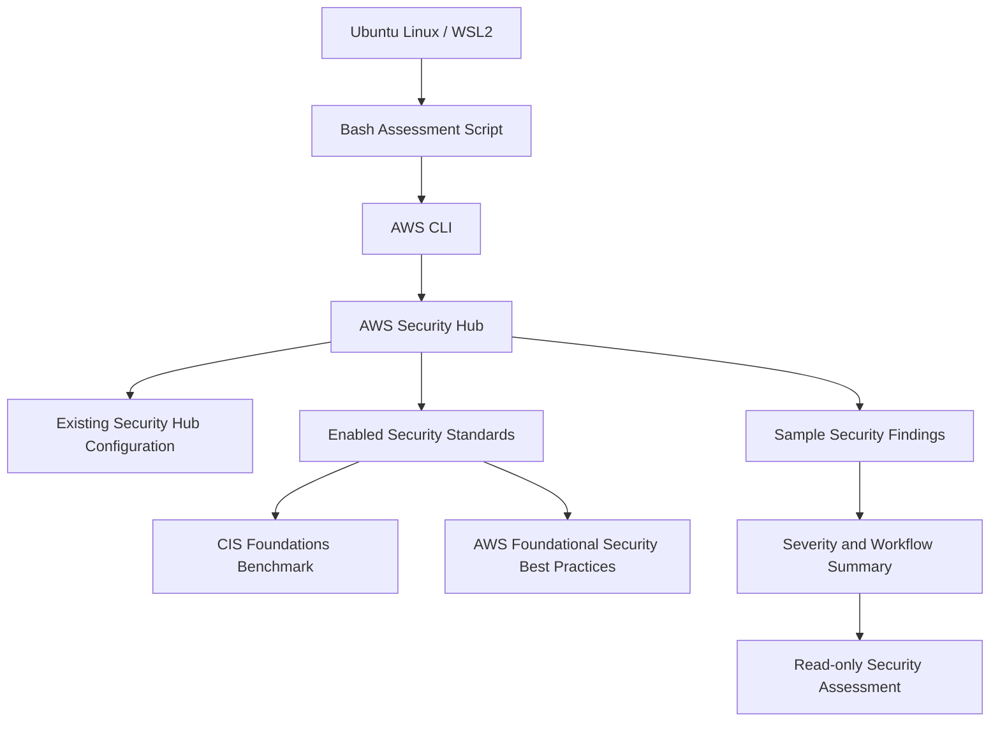
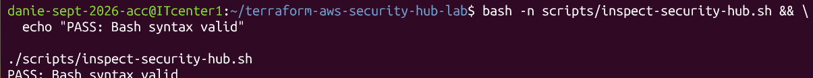

# AWS Security Hub Read-Only Assessment Lab

## Project Overview

This project demonstrates read-only security assessment
using AWS Security Hub, AWS CLI, Bash, and Ubuntu Linux.

The assessment inspects an existing Security Hub
configuration, enabled standards, and a sample of
security findings.

No AWS resources were created, updated, or deleted
by this assessment.

## Technologies

- AWS Security Hub
- AWS CLI
- Bash
- Ubuntu Linux / WSL2
- Git and GitHub

## Verified AWS Environment

- Region: us-east-1
- Security Hub: Enabled
- Automatic control enablement: True
- Control finding generator: SECURITY_CONTROL

## Architecture



## Enabled Security Standards

### CIS AWS Foundations Benchmark v1.2.0

Subscription status: READY

### AWS Foundational Security Best Practices v1.0.0

Subscription status: INCOMPLETE

These are subscription statuses, not compliance scores.

## Sample Security Findings

Ten findings were returned in the sample.

Severity:

- MEDIUM: 8
- INFORMATIONAL: 2

Workflow status:

- NEW: 9
- RESOLVED: 1

All ten returned findings had RecordState ACTIVE.

These observations do not represent the total
number of findings or overall compliance.

## Assessment Script

Run:

```bash
bash -n scripts/inspect-security-hub.sh
./scripts/inspect-security-hub.sh
```

Observed results:

SUCCESS: SECURITY HUB ASSESSMENT COMPLETED

READ-ONLY: NO AWS RESOURCES MODIFIED

## Validation Evidence

See [Validation Evidence](docs/validation-evidence.md).



## Deployment Status

READ-ONLY ASSESSMENT.

No Terraform deployment was performed.

No Security Hub settings or findings were modified.

## Security and Cost

- Do not publish AWS credentials or private keys.
- Do not publish detailed findings containing sensitive data.
- Do not modify security controls without authorization.
- Existing Security Hub features may incur AWS charges.
- Review costs before enabling additional services.
