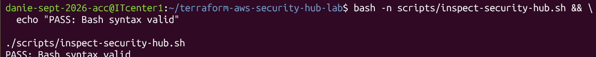

# AWS Security Hub Validation Evidence

## Environment

AWS Region: us-east-1

AWS account: 774305591665

IAM identity: 3rd-lab-user

## Security Hub Configuration

Security Hub: Enabled

AutoEnableControls: True

ControlFindingGenerator: SECURITY_CONTROL

## Enabled Standards

1. CIS AWS Foundations Benchmark v1.2.0
   Subscription status: READY

2. AWS Foundational Security Best Practices v1.0.0
   Subscription status: INCOMPLETE

These statuses are not compliance scores.

## Sample Findings

Sample size: 10

Severity:

- MEDIUM: 8
- INFORMATIONAL: 2

Workflow:

- NEW: 9
- RESOLVED: 1

RecordState:

- ACTIVE: 10

The sample does not establish account-wide
finding counts or compliance.

## Bash Validation

bash -n scripts/inspect-security-hub.sh: PASS

./scripts/inspect-security-hub.sh: PASS

Observed final output:

SUCCESS: SECURITY HUB ASSESSMENT COMPLETED

READ-ONLY: NO AWS RESOURCES MODIFIED

## Scope and Limitations

This assessment used existing Security Hub
configuration and sampled findings.

No remediation was performed.

No AWS resources were modified by the script.

## Screenshot

